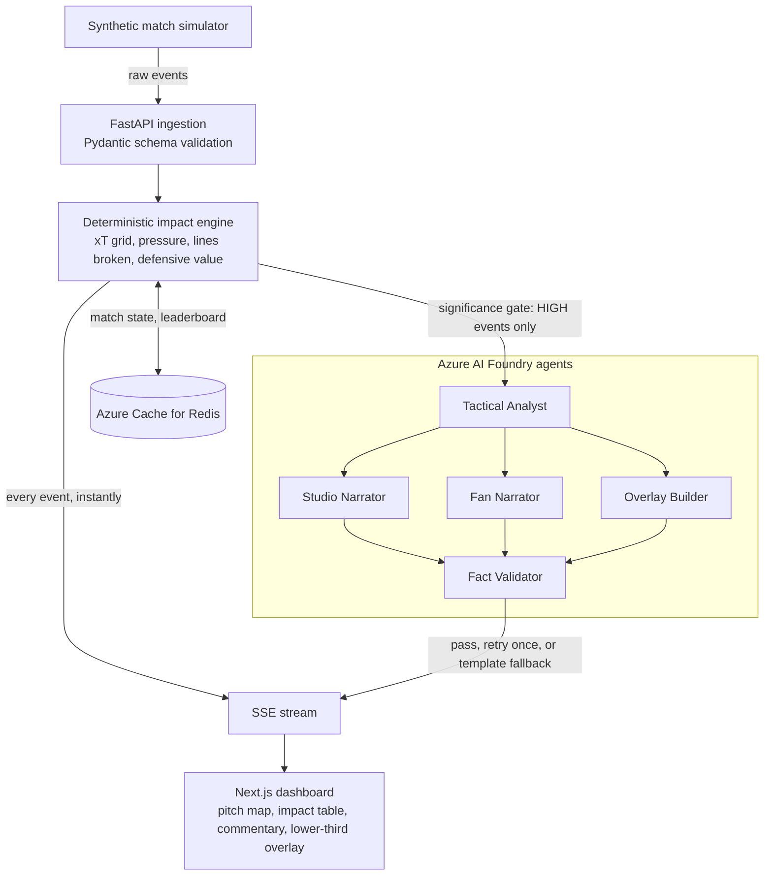

# Context-Aware Player Impact Engine

Live player impact and tactical commentary for football, built on Azure AI Foundry.

Most match commentary leans on box-score hype: goals, assists, pass counts. This project scores every action by how much it changes the **threat on the pitch**, then uses a small team of AI agents to explain *why* it mattered, in the voice of a studio analyst or a casual fan, with every number fact-checked against the engine before it is shown.

**Live demo:** https://match-web.calmpond-ea5a46a2.westus3.azurecontainerapps.io  
**Engine health:** https://match-engine.calmpond-ea5a46a2.westus3.azurecontainerapps.io/health

> **Why "Context-Aware" and not "Unbiased"?** Any model has assumptions. Ours are explicit, tunable and visible on screen. The claim is that scores are **consistent, explainable and independent of media hype**, and that the weights are stated openly rather than hidden.

## How it works



1. **Ingest.** A synthetic match simulator emits events (passes, carries, tackles, interceptions) with coordinates and opponent positions. FastAPI validates each one against a Pydantic schema.
2. **Calculate.** A deterministic Python engine computes the metrics below. No LLM is involved, so scores are reproducible and take milliseconds.
3. **Orchestrate.** Only high-impact events pass the significance gate. The **Tactical Analyst** explains the cause, then three agents run in parallel: **Studio Narrator**, **Fan Narrator** and **Overlay Builder**.
4. **Validate.** Every number in the narratives is checked in code against the engine's metrics, then a **Fact Validator** agent checks direction, location and claims. A failed check triggers one retry with the errors fed back, then a templated fallback.
5. **Deliver.** Server-Sent Events stream raw impact events immediately and insights as they finish. The dashboard shows a pitch map, a live impact table, commentary in two voices, and broadcast-style lower-thirds.

Because the maths is deterministic and the agents only explain it, the AI never invents a score. It can only describe the numbers it is given, and the validator rejects text that doesn't match them.

## The impact formula

Every action gets a score:

```
impact = ΔxT × (1 + 0.25 × P) + 0.02 × L
```

| Term | Meaning |
|---|---|
| **ΔxT** | Change in expected threat: `xT(end zone) − xT(start zone)` from a 16×12 pitch grid |
| **P** | Pressure on the ball carrier, 0 to 1: sum over opponents within 5 m of `(1 − distance/5)`, capped at 1 |
| **L** | Opposition lines broken (defence, midfield, attack) by the pass or carry |

Worked example: ΔxT 0.18, pressure 0.842, 3 lines broken gives `0.18 × (1 + 0.25 × 0.842) + 0.02 × 3 ≈ 0.28`.

Other action types:

- **Failed pass or carry:** `ΔxT = −0.5 × xT(start zone)`, so losing the ball in a dangerous area costs more.
- **Tackle or interception (defensive value):** credited with the threat the opponent would have had from that spot, `xT` at the mirrored location, when the action succeeds.
- **Significance:** `|impact| ≥ 0.15` is HIGH, `≥ 0.05` is MEDIUM, otherwise LOW. Only HIGH events reach the agents.

All weights and thresholds live in `engine/app/config.py`.

### Known limitations

- The xT grid is hand-built (threat rises toward goal and toward the centre), not learned from real tracking data.
- xT favours ball progression, which undervalues off-ball work. Defensive value and pressure weighting reduce, but do not remove, that skew.
- Coordinates are from the acting team's point of view, attacking toward x = 105. Away-team flipping is not implemented.
- All data is synthetic.

## Stack

| Layer | Technology |
|---|---|
| Agents | Azure AI Foundry prompt agents (5 agents), model set by env (we use `gpt-4.1-mini`) |
| Engine | Python 3.11+, FastAPI, Pydantic, NumPy |
| Streaming | Server-Sent Events (`/stream`) |
| Frontend | Next.js, TypeScript, Tailwind CSS, Framer Motion |
| State | Azure Cache for Redis (rolling match state, live leaderboard) |
| Hosting | Azure Container Apps (engine and web as separate containers) |
| CI/CD | GitHub Actions: test, build images, deploy |

## Run it locally

**Backend**

```bash
cd engine
python -m venv .venv && source .venv/bin/activate
pip install -r requirements.txt
az login                      # agents authenticate with DefaultAzureCredential
```

Create `engine/.env`:

```
FOUNDRY_PROJECT_ENDPOINT=https://<resource>.services.ai.azure.com/api/projects/<project>
FOUNDRY_ANALYST_MODEL=<deployment name>
FOUNDRY_NARRATOR_MODEL=<deployment name>
REDIS_URL=<redis connection string>
ALLOWED_ORIGINS=http://localhost:3000   # comma-separated web origins allowed by CORS
# MOCK_AGENTS=1               # run the whole pipeline without any model calls
```

```bash
uvicorn app.main:app --reload
```

Check `http://localhost:8000/health`. It reports `"agents": "live"`, `"mock"` or `"off"`.

**Frontend**

```bash
cd web
npm install
cp .env.local.example .env.local
npm run dev                   # http://localhost:3000
```

**Tests**

```bash
cd engine && python -m pytest -v
```

### API

| Endpoint | Description |
|---|---|
| `GET /health` | Status and agent mode |
| `GET /stream?n=300&delay=0.3&agents=true` | SSE stream of `impact` events (every action) and `insight` events (agent output) |

Example `impact` payload:

```json
{
  "match_id": "syn-001",
  "timestamp": "17:06",
  "event_type": "tackle",
  "player": {"id": "P2", "name": "Okafor", "team": "Home"},
  "location": {"start": [13.7, 34.3], "end": [13.7, 34.3]},
  "metrics": {"delta_xT": 0.181, "pressure": 0.868, "lines_broken": 0, "pass_difficulty": 0.0, "impact_score": 0.221},
  "cumulative": {"match_score": 0.218, "rank_on_pitch": 3},
  "significance": "HIGH"
}
```

## Deployment

The system runs on Azure in the West US 3 region as two Azure Container Apps (`match-web` and `match-engine`) backed by Azure Cache for Redis, with Azure AI Foundry hosting the agents.

Every push to `main` runs the tests, builds both container images, and deploys them through GitHub Actions.

| Setting | Where | Purpose |
|---|---|---|
| `FOUNDRY_PROJECT_ENDPOINT`, `FOUNDRY_ANALYST_MODEL`, `FOUNDRY_NARRATOR_MODEL` | engine app | Foundry project and model deployments |
| `REDIS_URL` | engine app (secret) | Match state and leaderboard |
| `ALLOWED_ORIGINS` | engine app | The web app's URL, so the browser can read the stream (CORS) |
| Managed identity with the **Foundry User** role | engine app | Agent calls authenticate without keys |
| `NEXT_PUBLIC_API_URL` | web build argument | Engine URL, baked into the Next.js build |

Secrets live in GitHub and Azure secrets, never in the repository.

## Responsible-AI design

- **Deterministic first.** Scores come from code, not a model.
- **Grounded generation.** Agents receive the computed metrics and a precomputed `zone` label, and are told to use only those. Location is never inferred from raw coordinates.
- **Two-layer fact check.** A free numeric check in code (every figure must match a metric or a simple derivation such as pressure as a percentage), then an LLM validator for direction, location and claims.
- **Safe failure.** One retry with the validator's errors, then a template built from the metrics. The stream never stops because an agent failed.
- **Cost control.** A significance gate sends only high-impact events to the models, and concurrent model calls are capped.

## Project layout

```
engine/
  app/
    main.py          FastAPI app and SSE stream
    schemas.py       Pydantic models
    simulator.py     synthetic match events
    impact.py        xT grid, pressure, lines broken, impact formula
    config.py        weights and thresholds
    mock.py          offline stand-in for the agents
    agents/
      foundry.py     Azure AI Foundry client wrapper
      analyst.py     Tactical Analyst
      narrators.py   Studio, Fan and Overlay agents
      validator.py   numeric and LLM fact checks
      pipeline.py    orchestration, retry and fallback
      gate.py        significance gate
  tests/
  Dockerfile
web/                 Next.js dashboard
  Dockerfile
docker-compose.yml   local engine + Redis
.github/workflows/   CI/CD pipeline
```

## Roadmap

- Away-team coordinate handling.
- Fit the xT grid to real event data.
- Per-session match state so several viewers can watch independent replays at the same time.